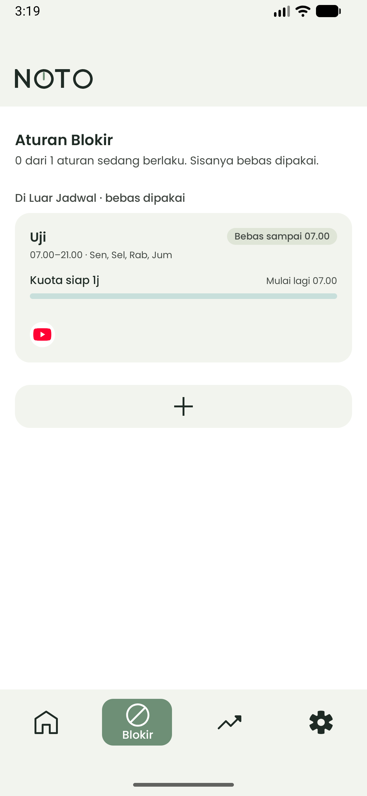
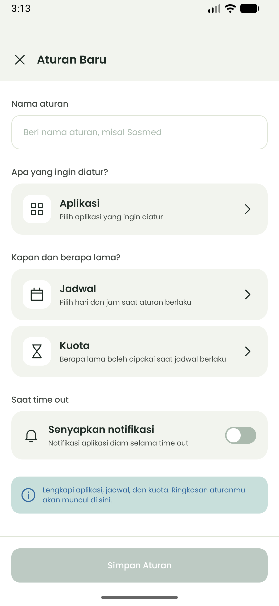
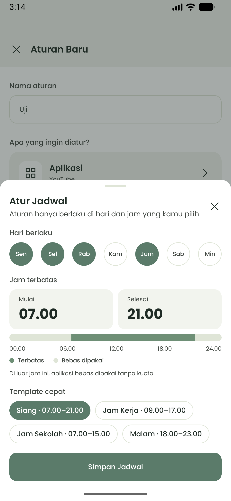
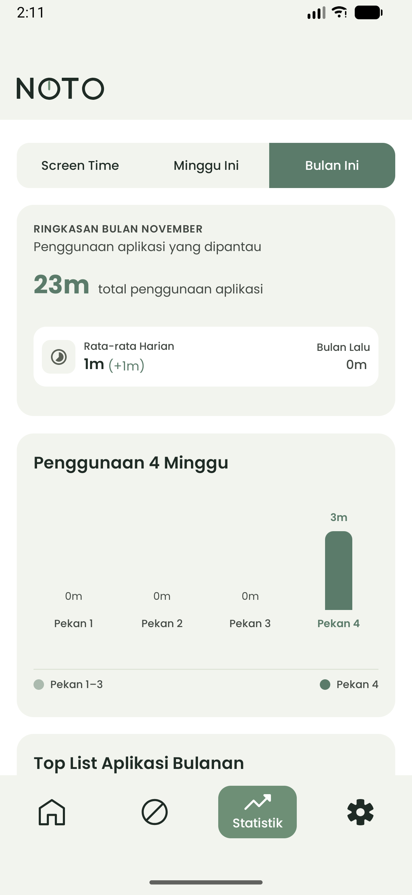
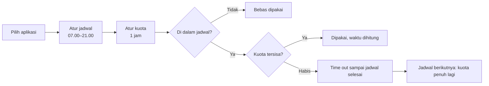

<div align="center">

# Noto

**Notice Your Time Out.** Batasi aplikasi dengan jadwal dan kuota screen time, tanpa memblokirnya seharian.

*Noto wektu, noto urip. Menata waktu, menata kehidupan.*

[](https://github.com/LollYeahhh/NOTO-MOBILE-APP/releases/latest)
[](https://github.com/LollYeahhh/NOTO-MOBILE-APP/releases)
[](#-unduh-dan-pasang)
[](LICENSE)

[](https://github.com/LollYeahhh/NOTO-MOBILE-APP/releases/latest)






</div>

---

## ✨ Apa itu Noto?

Noto adalah aplikasi Android untuk mengatur pemakaian aplikasi lewat **jadwal** dan **kuota screen time**.

Contohnya: Sosmed boleh dipakai **1 jam** antara **07.00–21.00**. Selama jadwal berlaku, waktu hanya dihitung saat aplikasinya dibuka. Kalau kuota habis, aplikasinya **time out** sampai jadwal selesai. Di luar jadwal, semuanya **bebas dipakai**.

Bukan hukuman, melainkan pengingat bahwa sekarang saatnya berhenti sejenak.

## ⬇️ Unduh dan Pasang

| | |
| --- | --- |
| Versi terbaru | **v0.1** (November 2026) |
| Butuh | Android 8.0 (Oreo) atau lebih baru |
| Ukuran | ± 2 MB |
| Bahasa | Indonesia, English |

1. Buka halaman **[Rilis terbaru](https://github.com/LollYeahhh/NOTO-MOBILE-APP/releases/latest)**, lalu unduh `noto-v0.1.apk` di bagian **Assets**.
2. Buka file-nya. Kalau diminta, izinkan pemasangan dari sumber ini.
3. Buka Noto, lalu ikuti petunjuk izinnya.

> Noto belum tersedia di Google Play. Versi Play sedang disiapkan.

## 🧩 Fitur

- **Aturan untuk sekelompok aplikasi** dengan kuota bersama, hari berlaku, dan jam terbatas.
- **Kunci otomatis** saat kuota habis, sampai jadwal selesai. Layar time out dilengkapi latihan napas singkat.
- **Kuota kembali penuh** setiap jadwal dimulai.
- **Bebas di luar jadwal**, tanpa hitungan apa pun.
- **Statistik**: Screen Time hari ini, Minggu Ini, dan Bulan Ini.
- **Pengingat**: sisa kuota, kuota habis, jadwal mulai dan selesai, ringkasan harian dan mingguan, serta jam tenang.
- **Tidak mudah menyerah**: jeda hitung mundur sebelum mematikan aturan, dan kunci edit selama time out.

## ⚙️ Cara Kerja



## 🔒 Izin dan Privasi

Semua data tetap di perangkatmu. Noto **tidak meminta izin internet**, tidak ada iklan, dan tidak ada akun.

| Izin | Untuk apa |
| --- | --- |
| Akses penggunaan | Menghitung lama pemakaian aplikasi |
| Notifikasi | Pengingat dan notifikasi "Noto sedang berjalan" |
| Tampil di atas aplikasi lain | Menampilkan layar time out |
| Baterai tanpa pembatasan | Supaya Noto tidak ditutup sistem |
| Aksesibilitas *(opsional)* | Mengunci lebih cepat. Hanya membaca nama aplikasi yang dibuka, bukan isi layar, ketikan, atau pesan |

Baca selengkapnya di **[Kebijakan Privasi](docs/rilis/kebijakan-privasi.md)**.

## 📦 Riwayat Rilis

### v0.1 — November 2026

Rilis pertama. Semua fitur versi 1:

- Aturan pembatasan dengan jadwal dan kuota bersama
- Penguncian otomatis dan reset kuota otomatis
- Statistik harian, mingguan, dan bulanan
- Notifikasi, pengingat, ringkasan, dan jam tenang
- Setelan aturan pembatasan: bawaan aturan baru, jeda sebelum mematikan, kunci edit saat time out
- Aksesibilitas opsional untuk penguncian lebih cepat

Lihat semua rilis di **[halaman Releases](https://github.com/LollYeahhh/NOTO-MOBILE-APP/releases)**.

## 🛠️ Build dari Kode Sumber

Butuh Android Studio versi terbaru (JDK 17+).

```bash
git clone https://github.com/LollYeahhh/NOTO-MOBILE-APP.git
cd NOTO-MOBILE-APP
./gradlew assembleDebug
```

APK debug ada di `app/build/outputs/apk/debug/`.

Untuk build release yang ditandatangani, buat `keystore.properties` di akar proyek (file ini tidak ikut di-commit):

```properties
storeFile=/path/ke/kunci.jks
passwordFile=/path/ke/sandi.txt
keyAlias=nama-alias
```

Lalu jalankan `./gradlew assembleRelease` atau `./gradlew bundleRelease`.

| Komponen | Teknologi |
| --- | --- |
| Bahasa | Kotlin |
| UI | Jetpack Compose (Material 3) |
| Arsitektur | MVVM |
| Penyimpanan | Room (aturan, pemakaian), DataStore (setelan) |
| Pelacakan | UsageStats API dalam foreground service |
| Penguncian | Layar time out di atas aplikasi lain, Accessibility Service opsional |
| Penjadwalan | AlarmManager |
| Min SDK | 26 (Android 8.0) |

## 🌱 Tentang Noto

<details>
<summary><b>Latar belakang</b></summary>

<br>

Pada malam tanggal 3 Oktober 2026, saya mencari aplikasi yang bisa memblokir aplikasi lain. Namun, tidak ada yang benar-benar sesuai dengan kebutuhan saya: membatasi aplikasi **hanya pada jam tertentu** dengan **kuota waktu**, bukan memblokirnya sepanjang hari.

Dari situ, Noto dibuat sebagai aplikasi sendiri dengan fitur yang memang sesuai dengan yang saya inginkan.

Masalah penggunaan smartphone sering kali bukan karena aplikasi tertentu harus dihindari, tetapi karena **waktu penggunaannya tidak terkontrol**.

</details>

<details>
<summary><b>Filosofi nama</b></summary>

<br>

Nama **Noto** punya dua makna sekaligus.

**1. Notice Your Time Out.** **N**otice y**O**ur **T**ime **O**ut. *Notice* berarti menyadari, *time out* berarti jeda. Digabung, Noto mengajak pengguna menyadari ke mana waktunya pergi dan kapan waktunya berhenti sejenak.

**2. Noto dalam bahasa Jawa** berarti **menata** atau **mengatur**.

> ✨ **Noto wektu, noto urip.** *Menata waktu, menata kehidupan.*

| Asal | Makna | Peran |
| --- | --- | --- |
| **Notice Your Time Out** (Inggris) | Menyadari waktu dan kapan harus berhenti | 👁️ *Kesadaran* |
| **Noto** (Jawa) | Menata kehidupan dengan mengatur screen time | 🛠️ *Tindakan* |

> 💬 **Sadari** waktumu, lalu **tata** hidupmu.

</details>

<details>
<summary><b>Contoh pemakaian</b></summary>

<br>

| Skenario | Aplikasi | Jadwal | Kuota |
| --- | --- | --- | --- |
| 🎓 Pelajar | Sosial media | 07.00–21.00 | 1 jam |
| 🎮 Gaming | Game | 08.00–20.00 | 2 jam |
| 🧘 Digital wellbeing | Aplikasi hiburan | 07.00–21.00 | Terbatas, bebas 21.00–07.00 |

</details>

<details>
<summary><b>Prinsip desain</b></summary>

<br>

| Prinsip | Penjelasan |
| --- | --- |
| 🤝 **Control, Not Punishment** | Noto tidak menghukum pengguna. Tujuannya memberi kontrol atas waktu. |
| 🌊 **Flexible, Not Absolute** | Tidak perlu memblokir aplikasi seharian. Pembatasan hanya di periode tertentu. |
| 👀 **Awareness Before Restriction** | Pengguna bisa melihat bagaimana waktunya digunakan sebelum aplikasi dibatasi. |

</details>

## 💬 Masukan

Menemukan bug atau punya ide? Buka **[Issue](https://github.com/LollYeahhh/NOTO-MOBILE-APP/issues)**, atau kirim masukan dari Noto: **Setelan → Tentang Noto → Kirim masukan**.

## 📄 Lisensi

Kode Noto dirilis dengan **[Lisensi MIT](LICENSE)** © 2026 HKL.
Font Poppins memakai **[SIL Open Font License 1.1](licenses/Poppins-OFL.txt)**.
